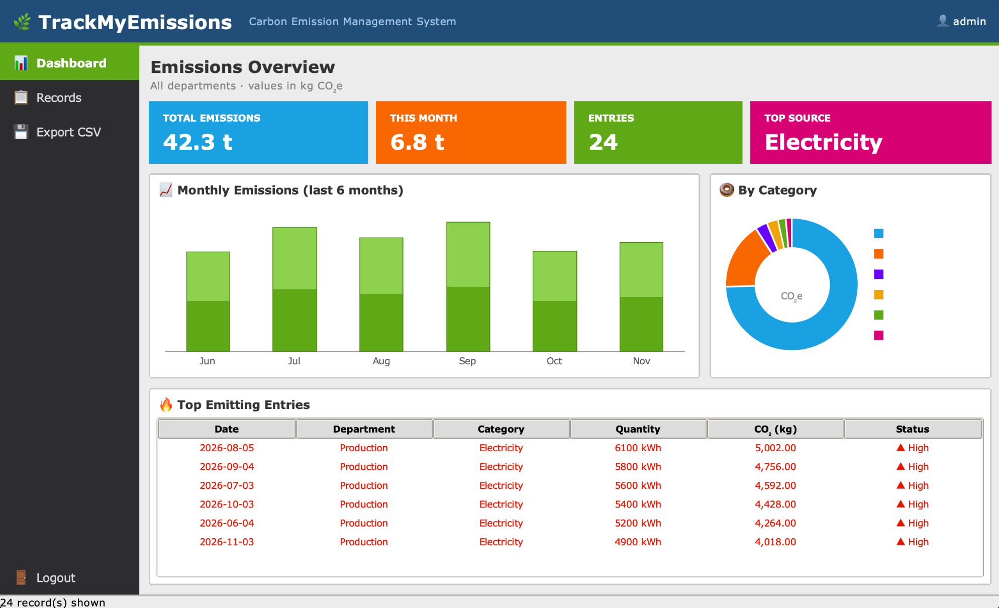
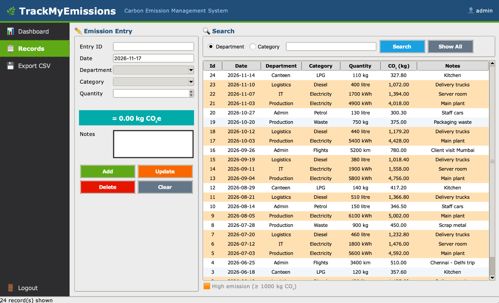
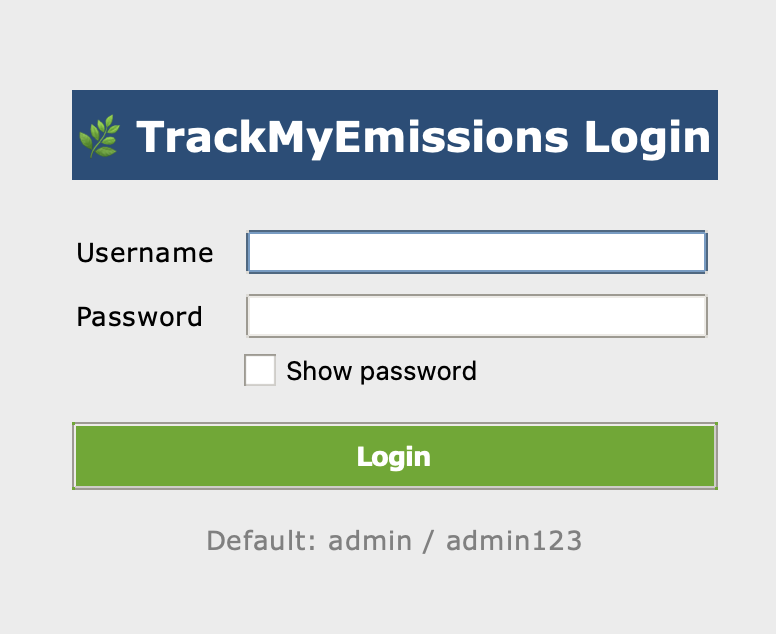

# 🌿 TrackMyEmissions

_Carbon Emission Management System_ built with Python, Tkinter and MySQL.







**Features:** login, a dashboard (coloured tiles, a monthly bar chart, a category donut chart and a top-emitters table), and records management. Records support add, update and delete with a live CO₂ preview, search by department or category, high-emission highlighting, and CSV export.

## Run on Windows

**One-time setup**
1. Install [Python 3](https://www.python.org/downloads/). On the first screen, tick **"Add python.exe to PATH"**.
2. Install [MySQL Server](https://dev.mysql.com/downloads/installer/) using the *MySQL Installer*. Choose **Server only**, set a **root password**, and remember it.

**Start the app.** Open **PowerShell** and run:

```powershell
git clone https://github.com/thiyatira/TrackMyEmissions.git
cd TrackMyEmissions
pip install -r requirements.txt
$env:DB_PASSWORD="your_mysql_root_password"
python app.py
```

> No git? Click **Code → Download ZIP** on GitHub, extract it, and open PowerShell in that folder.
> Using cmd instead of PowerShell? Write `set DB_PASSWORD=your_mysql_root_password`.

The database and sample data are created automatically from `schema.sql` on first run.

Login: **admin / admin123**
